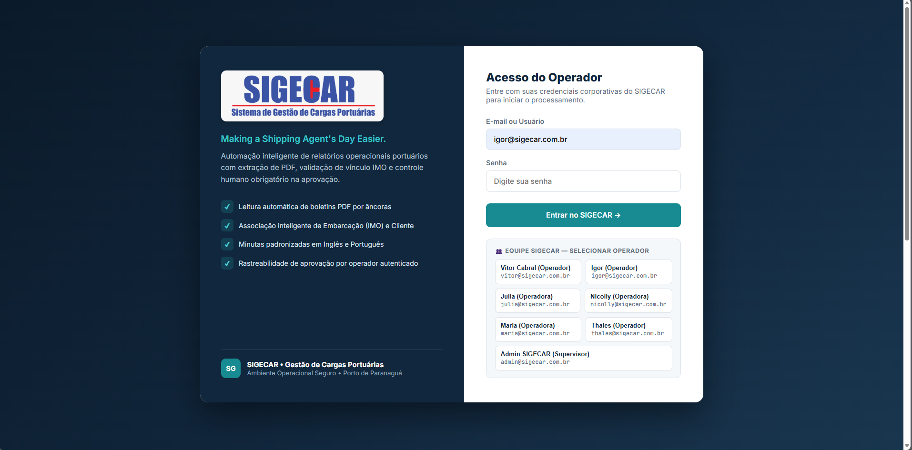
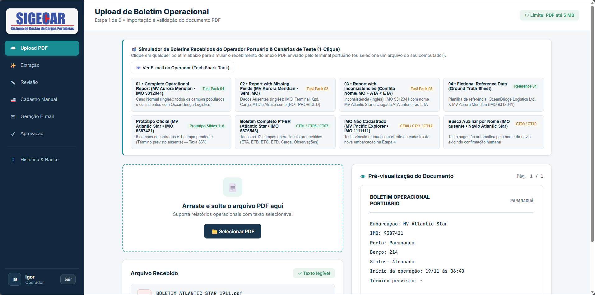
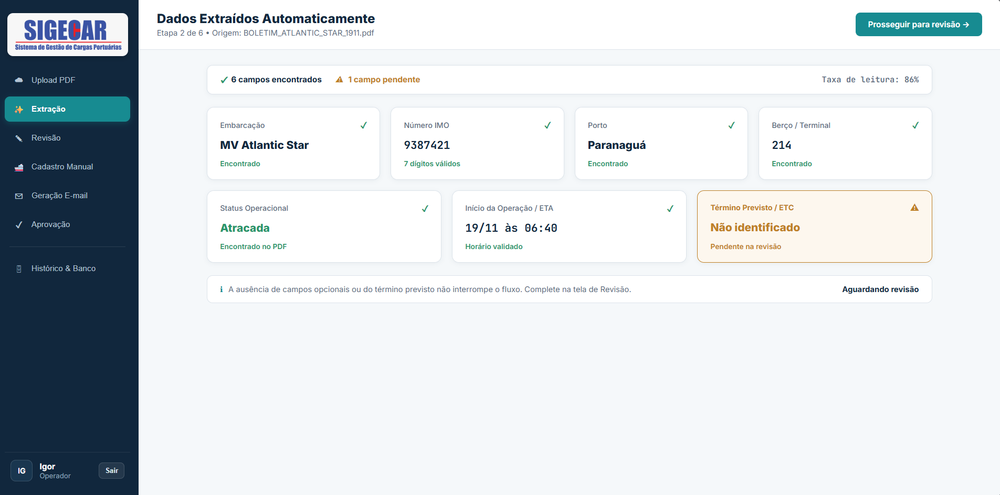
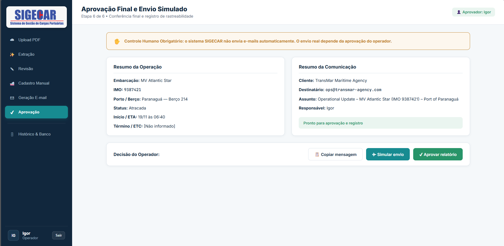
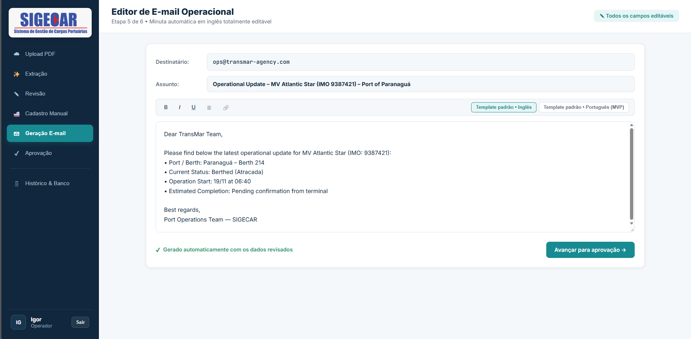
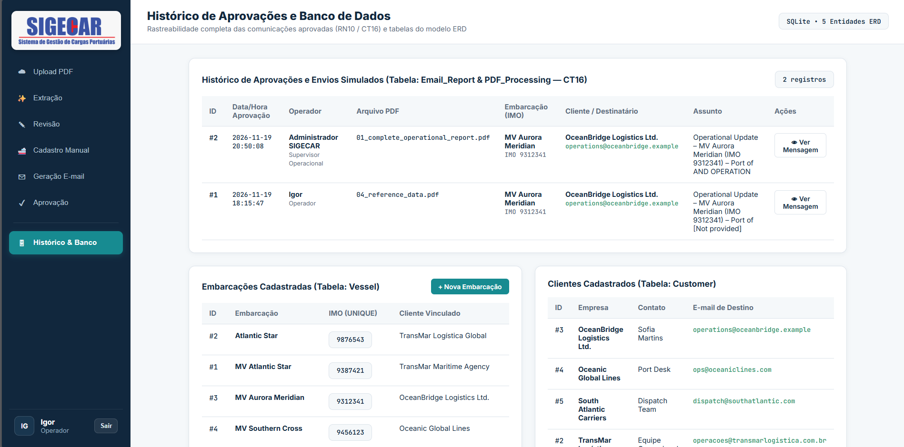
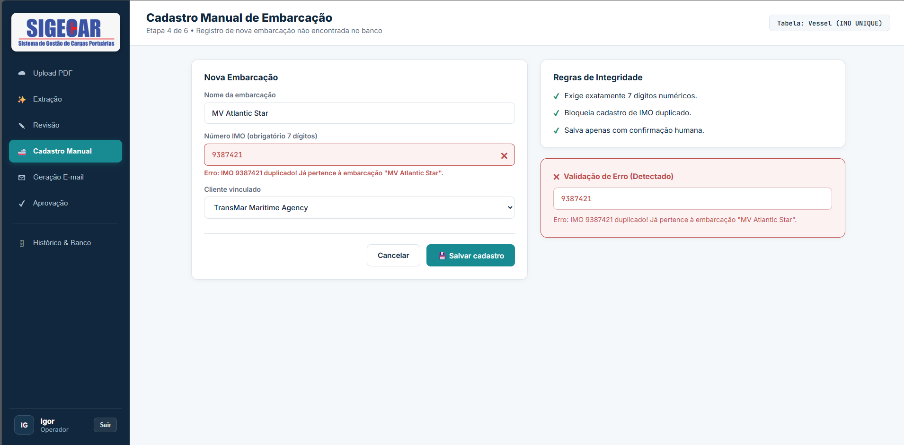

# PORTFLOW

  

  <strong>Intelligent Document Processing and Operational Workflow for Maritime Agencies</strong>

---

## About the Project

PORTFLOW is a functional web prototype developed to streamline the processing of operational PDF documents in maritime agencies.

The system addresses the manual workflow of reviewing port operation bulletins, extracting relevant information and preparing standardized email updates for international clients.

The prototype, branded as SIGECAR in its interface, combines document processing, operator traceability and an approval-oriented workflow.

## The Problem

Maritime agents receive operational documents containing information about vessel movements, cargo operations, interruptions and schedules.

Manually reviewing these documents and preparing client updates can be time-consuming and susceptible to human error.

## The Solution

PORTFLOW provides a web-based workflow that supports the upload and processing of operational PDFs, information review, manual data registration, email report preparation, approval and historical tracking.

## Key Features

- **PDF Upload:** Upload operational documents for processing.
- **Information Extraction:** Extract operational information from PDF documents.
- **Data Review:** Review extracted information within the operational workflow.
- **Manual Registration:** Support manual registration of operational data.
- **Email Report Generation:** Prepare standardized operational email reports.
- **Approval Workflow:** Support the review and approval of reports.
- **History and Traceability:** Track operational records and actions associated with users.
- **Authentication:** Login system with operator identification.

## System Screenshots

<!-- Update image paths if the actual filenames differ. -->

### Login

### Document Upload

### Data Review

### Approval Workflow

### Email Reports

### History

### Registration

## Architecture

PORTFLOW uses a web-based architecture composed of a frontend, a Python backend, a relational database and PDF processing logic.

For further details, see [System Architecture](docs/architecture.md).

## Technologies

| Technology | Purpose |
|---|---|
| Python | Backend logic and application functionality |
| Flask | Web framework and API |
| SQLite | Relational database and data persistence |
| pypdf | PDF reading and extraction |
| HTML | Interface structure |
| CSS | Interface styling |
| JavaScript | Frontend interactions and API communication |

See [Technologies](docs/technologies.md) for more information.

## Operational Workflow

1. User authentication.
2. Operational PDF upload.
3. Document validation and information extraction.
4. Review of extracted information.
5. Manual registration when necessary.
6. Email report preparation.
7. Approval workflow.
8. History and traceability.

See [Operational Workflow](docs/workflow.md) for details.

## Testing

The project includes an automated test suite designed to cover authentication and 17 acceptance scenarios (CT01–CT17).

The tests are documented in the project's source code.

## Project Documentation

- [System Architecture](docs/architecture.md)
- [Operational Workflow](docs/workflow.md)
- [Technologies](docs/technologies.md)
- [Team and Contributions](docs/team.md)

## Project Presentation

The project was developed as part of the Tech Shark Tank challenge at ISULPAR, within the English for Information Systems course.

[View the project presentation](docs/presentation.pdf)

## Team

See [Team and Contributions](docs/team.md) for information about the team and individual contributions.

---

**PORTFLOW — Making a Shipping Agent's Day Easier.**